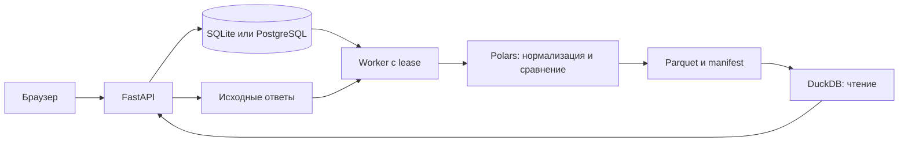

# Архитектура и контракты

Браузер React обращается к FastAPI. API записывает задания в SQL; отдельный worker атомарно захватывает задание, поддерживает heartbeat и строит изолированный каталог Parquet. Читатели DuckDB открывают собственные in-memory соединения к завершённым файлам. Публикация — переименование временного каталога после проверки SHA-256; SQL-статус меняется затем. Если процесс остановился между переименованием и SQL-коммитом, worker восстанавливает статус по manifest.

`SPR_DATA/sources/PROJECT/DATASET/FILE_ID` хранит исходные байты. SQL File содержит имя, формат, размер и SHA-256. `SPR_DATA/artifacts/PROJECT/DATASET/RUN` содержит normalized, comparison, quality, segments, products, membership, facts (Parquet), checks, profile, summary, timings, snapshot и manifest (JSON). Новый пересчёт всегда создаёт RUN. Секреты подключений не должны входить в профили и код.

Нормализация сохраняет APP_ID, SOURCE, PREFIX, CLASS, SUFFIX, ARRAY_KEY, KEY, VALUE, ADJUSTED_VALUE, PATH, TYPE, ADDRESS, KEY_JSON и PRESENT. KEY_JSON — однозначный ключ вложенных массивов; ARRAY_KEY — совместимая отображаемая проекция. Сравнение сохраняет исходные значения, типы и наличие обоих срезов. Четыре состояния: SAME, VALUE_CHANGED, ATTRIBUTE_NEW, ATTRIBUTE_LOST. Отсутствующий ответ исключает заявку из основной сравнительной выборки.

Факты используют VALUE_ADJUSTED (явное переименование ADJUSTED_VALUE). CNT всегда означает distinct APP_ID внутри конкретной группы. membership сохраняет принадлежность, поэтому сводная и drill-down применяют одинаковый предикат. Суммировать CNT разных атрибутов для получения количества заявок нельзя.

## Выборки

- discovered: уникальные обнаруженные/ожидаемые APP_ID, включая повреждённые и неполные пары.
- valid_before / valid_after: успешно нормализованный ответ без конфликтующего дубля в соответствующем срезе.
- valid_pairs: пересечение этих множеств. Это знаменатель основных сравнительных KPI.
- excluded: discovered минус valid_pairs.
- changed_apps: distinct APP_ID, имеющие хотя бы один DIFF_FLAG=1 в валидной паре.
- decision_changed: число валидных пар с разными значениями поля решения профиля.
- changes: количество изменившихся атрибутов; normalized_rows: число строк обоих срезов до ограничения валидными парами.

## Адаптеры

`parse(bytes, format, profile) -> dict` поддерживает JSON/XML/CSV. Новый адаптер должен возвращать объект общей модели или выбрасывать ошибку, которая попадёт в quality. CSV: один документ — одна строка; вложенные поля задаются точечными именами, массивы и объекты — JSON-ячейками. XML: внешние сущности запрещены; сохранение namespace регулируется `xml_namespaces`. Профиль содержит root, mapping (целевой путь → исходный), types, required, exclude, arrays, buckets, decision_path и пути продуктовых разрезов. Примеры — profiles/*.json.

## Процедуры

Конструктор подключает процедуры разбора, нормализации, сравнения и формирования фактов. Проверки используют `CHECK = {id, label, params, entrypoint}` и `run(mart, params) -> list[dict]`. MartAPI предоставляет `rows`, `count`, `app_ids`, `segments` и `total_apps`. Порядок проверок, профиль, код, параметры и входные файлы сохраняются в снимке запуска.

Python выполняется в отдельном процессе. Публичное развёртывание использует ограничения ОС. Локальный запуск через `launch.py` использует доверенный режим, включая Windows. [Контракты процедур](procedure-contracts.md) · [Развёртывание](deployment.md)
