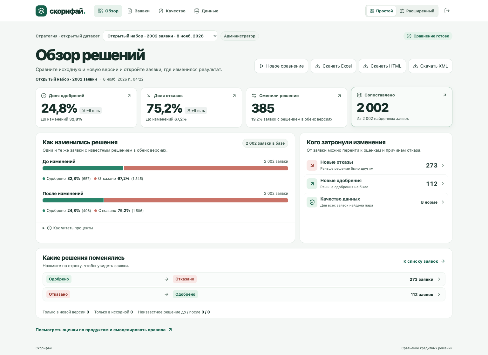

# Скриншоты Скорифая

Скриншоты сделаны в локальном интерфейсе на открытом наборе организаторов `RUN-20260827-0001`. Сравнивались ответы `BEFORE_MASTER` и `AFTER_BETA` с профилем `main` и пятью комплектными проверками Python.

Из 4 004 файлов получено 2 002 валидные пары. Различия найдены в 502 заявках, в том числе в 385 сменилось решение. В 273 случаях одобрение сменилось отказом, в 112 случаях отказ сменился одобрением.

| Экран | Что показано |
| --- | --- |
| [01. Простой обзор](01-simple-overview.png) | Доля одобрений снизилась с 32,8% до 24,8%. Под диаграммой видны оба направления смены решения. |
| [02. Расширенный обзор](02-advanced-overview.png) | Объём выборки, число заявок с различиями и переходы между решениями. |
| [03. Сводная таблица](03-pivot.png) | Сравнение срезов по группам полей с фильтром «Только изменения». Числа в ячейках открывают списки заявок. |
| [04. Карточка заявки](04-application-comparison.png) | Смена решения с отказа на одобрение, значения поля в двух версиях и переход к исходным документам. |
| [05. Проверки Python](05-python-checks.png) | Результаты до и после изменений. Пять процедур вернули 2 результата `PASS` и 30 `FAIL` по бизнес-условиям без ошибок исполнения. |
| [06. Качество данных](06-data-quality.png) | Успешно прочитаны все ответы в обоих срезах. Исключённых заявок нет. |
| [07. Конструктор обработки](07-constructor.png) | Выбран открытый набор, профиль `main` и пять проверок. |
| [08. Журнал прогона](08-run-journal.png) | Завершённые этапы, фактическое время обработки и подробности чтения файлов. |

[Контрольная сверка с эталоном](../acceptance-result.json) · [Руководство пользователя](../user-guide.md)

